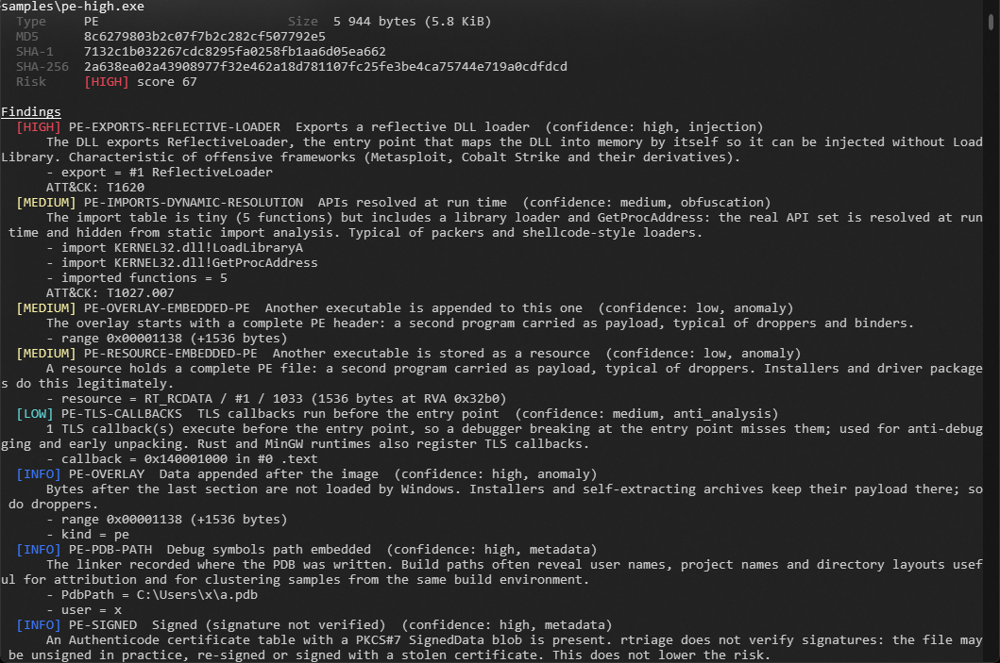
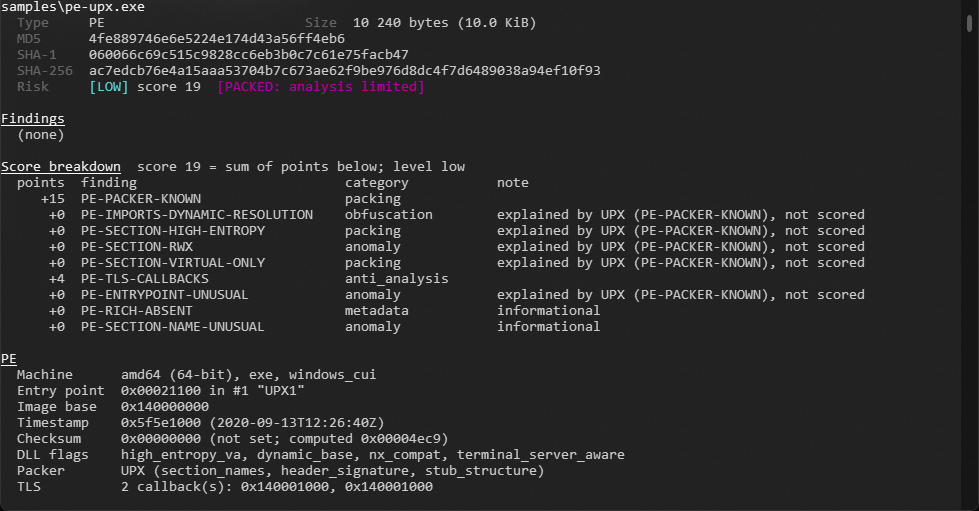
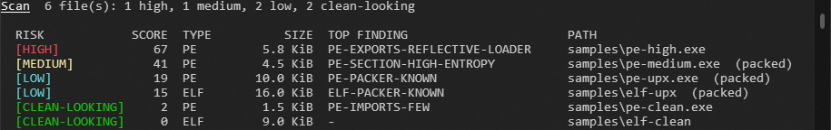
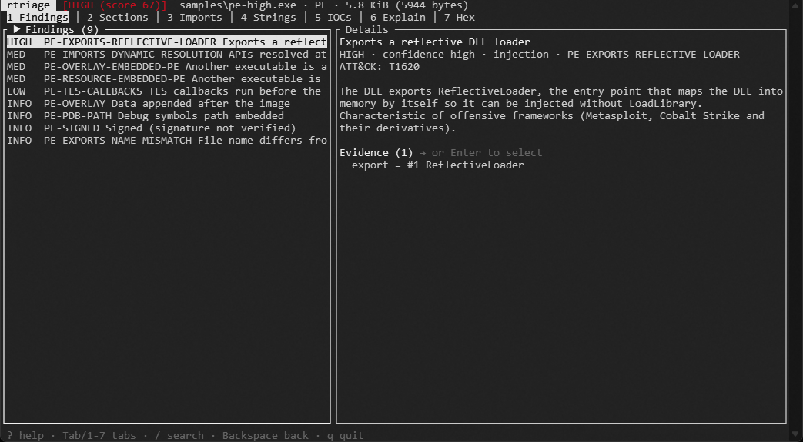

<p align="center"><picture>
  <source media="(prefers-color-scheme: dark)" srcset="assets/brand/rtriage-logo-dark.svg">
  
</picture></p>

<p align="center"><b>Static triage for PE and ELF binaries</b><br>
English · <a href="README.uk.md">Українська</a></p>

Given files or directories, `rtriage` answers in seconds: *what is this file,
does it look suspicious, and why?* Every finding carries the concrete
evidence that triggered it (offset, section, import, string, entropy value),
and the risk score is explainable down to each point.

**rtriage never executes, loads or emulates the files it analyzes.** Every
input is treated as hostile: parsers are bounded and panic-free, output is
sanitized against terminal escape injection, and batch runs analyse each
file in an isolated worker process.

> **Status: v0.1.0, the first public release.** Milestones 1–6 are done
> (core, PE, ELF + IOCs, YARA + batch mode, TUI, Markdown output). Before 1.0
> the CLI may still change between minor versions; the JSON schema follows the
> versioning rules in
> [`docs/output-schema.md`](docs/output-schema.md).

## Screenshots

All screenshots use the synthetic files from `samples/` (see
[Development](#development)); no real malware.

| Report | Score breakdown (`--explain`) |
|---|---|
|  |  |
| **Batch table (`scan`)** | **Interactive view (`tui`)** |
|  |  |

## Install

### Prebuilt binaries

[GitHub Releases](https://github.com/VoroN5k/rtriage/releases) have
archives for Linux x86_64, Windows x86_64, macOS Apple Silicon and macOS
Intel, built with YARA and the TUI. Each archive holds the `rtriage` binary,
`LICENSE` and this README.

Verify what you downloaded before running it:

```bash
# Linux / macOS: checksums (SHA256SUMS is attached to the release)
sha256sum -c SHA256SUMS --ignore-missing        # macOS: shasum -a 256 -c SHA256SUMS --ignore-missing

# Windows (PowerShell): compare with the line in SHA256SUMS
Get-FileHash -Algorithm SHA256 .\rtriage-v0.1.0-x86_64-pc-windows-msvc.zip

# Provenance: the archive was built by this repository's release workflow
gh attestation verify rtriage-v0.1.0-<target>.tar.gz --repo VoroN5k/rtriage
```

**The binaries are not code-signed.** Signing certificates cost money and
tie the project to a vendor; instead every release has checksums and a
build provenance attestation you can check yourself. Windows SmartScreen
and macOS Gatekeeper will warn about an unknown publisher. Once you have
verified an archive, allowing it (on macOS, for example
`xattr -d com.apple.quarantine rtriage`) is your decision.

### From source

```bash
cargo install --git https://github.com/VoroN5k/rtriage --locked --features yara rtriage-cli
```

Needs Rust 1.95 or newer (see [Building](#building)). Leave out
`--features yara` for a smaller build without YARA.

## Security model

- **Static only.** Input files are read, never executed, loaded or
  emulated.
- **Hostile input by default.** Parsers are bounded by configurable limits
  (file size, counts, string lengths, time per file), never panic on
  malformed data, and are fuzzed and property-tested.
- **Safe output.** Control characters, escape sequences, bidi and invisible
  characters from the file are escaped in the terminal; in Markdown every
  file value is a code span, so nothing becomes a link, image or HTML.
- **Isolation.** Batch runs analyse each file in a separate worker process;
  a crash, hang or flood loses only that file.
- **No network, no telemetry.** rtriage makes no network connections.

How to report a vulnerability: [`SECURITY.md`](SECURITY.md).

## Limitations

- **No unpacking.** rtriage is static: a packed file shows the packer and
  its traces, not the payload inside.
- **Heuristics, not verdicts.** Findings can be false positives, and the
  risk score ranks files for a closer look; it does not say a file is
  malware or safe.
- **Signatures are not validated.** Authenticode is reported as present
  ("signed (unverified)"), not checked.
- **Formats:** PE and ELF only. No Mach-O, .NET IL, scripts or Office
  documents.
- **YARA** runs only in builds with the `yara` feature (release binaries
  have it).
- **Pre-1.0.** The CLI may change between releases; the JSON schema is
  versioned (`schema_version`).
- **Unsigned binaries** (see [Install](#install)).

## What it looks at

- **Any file:** hashes, entropy (whole file and high-entropy regions),
  ASCII/UTF-16 strings with classification, IOCs (URLs, domains, IPs with
  scope, emails, wallets; allowlist; defang), YARA rules.
- **PE:** headers, sections, imports + pefile-compatible imphash, API
  behavior groups (injection, persistence, C2, credential access, ...),
  exports, resources, Rich header, TLS callbacks, debug/PDB paths, overlay,
  Authenticode presence, packers (UPX confirmed by several indicators).
- **ELF:** headers, interpreter, segments/sections, dynamic section and a
  checksec-style hardening summary, symbols and API behavior groups, notes,
  UPX, Go/Rust runtime recognition.

Findings, their thresholds and false-positive notes:
[`docs/heuristics.md`](docs/heuristics.md).

## Building

```bash
cargo build --release -p rtriage-cli                        # TUI, no YARA (small, fast to build)
cargo build --release -p rtriage-cli --features yara        # TUI + YARA (yara-x)
cargo build --release -p rtriage-cli --no-default-features  # neither: plain CLI
```

| Build | Binary | Clean release build | Dependencies of `rtriage-cli` |
|---|---|---|---|
| default (TUI) | ~4.7 MiB | ~1 min | 116 crates |
| `--no-default-features` | ~4.2 MiB | ~1 min | 73 crates |
| `--features yara` | ~17 MiB | ~6 min | 262 crates |

(Windows x86_64; crates counted with `cargo tree -e normal`.)

**MSRV:** Rust 1.95 or newer (`rust-version` in `Cargo.toml`; the
development toolchain is pinned in `rust-toolchain.toml`). The `test-hooks`
feature exists only for the worker-isolation tests; never enable it in a
build you ship.

## Usage

```bash
rtriage sample.exe                        # full report, analyzed in-process
rtriage --explain sample.exe              # ... plus the score breakdown
rtriage -f json -o report.json sample.exe # versioned JSON
rtriage --defang sample.exe               # hxxp://evil[.]com, 1[.]2[.]3[.]4 in text
rtriage -f md sample.exe > report.md      # Markdown for a ticket, issue or wiki

rtriage samples/                          # every file, full reports, worker processes
rtriage scan samples/ -j 8                # batch table sorted by risk
rtriage scan samples/ -f json > out.ndjson          # NDJSON, one summary line
rtriage scan samples/ --full -f json > out.ndjson   # ... plus one line per report
rtriage scan samples/ -f md               # Markdown table sorted by risk

rtriage scan samples/ --fail-on medium    # exit 3 if any file is medium or worse (CI)
rtriage --rules-dir my-rules/ sample.exe  # your rules layered over the bundled ones
rtriage --yara extra.yar --yara rules/ x  # extra YARA rules (yara build)
rtriage --no-yara sample.exe              # skip YARA, even the bundled rules

rtriage tui sample.exe                    # interactive view (see below)
```

| Invocation | Where files are analyzed | Output |
|---|---|---|
| one file | in this process | full report |
| several files, any directory | isolated worker processes (`-j`) | full reports in input order |
| `scan` | isolated worker processes | table sorted by risk (or NDJSON) |

Directories are walked recursively, sorted, without following symlinks;
FIFOs and devices are skipped. A worker that crashes, hangs past
`--timeout` + 5 s, or floods its output loses only the file it was on; the
file is reported as `crashed`, `timed_out` or `invalid_response` and a
fresh worker continues.

### Markdown output

`-f md` writes one document (`# rtriage report`) for a ticket, issue or
wiki page: the same sections as the text report, tables where text has
columns, several files in input order separated by rules, then failed and
skipped files. `scan -f md` writes the risk table first and, with
`--full`, every report after it.

- **Nothing from the file becomes markup.** Every value taken from the
  file (names, strings, paths, evidence, YARA rule names, the file name in
  headings) is an inline code span, so a rendered page shows no links,
  images, HTML, @mentions or #references. Values longer than 200
  characters are cut with their full length noted; finding details up to
  1 000.
- **Always defanged.** URLs, domains, IPs and emails appear as
  `hxxp://evil[.]com`, `1[.]2[.]3[.]4`. `--no-defang` shows them as found;
  `--defang` changes nothing in Markdown.
- **Size limit.** GitHub rejects issue and comment bodies over 65 536
  characters, so documents stop at 60 000 by default (`--md-limit N`,
  `0` = no limit). The cut is on a line boundary (tables keep whole rows)
  and a note says how many lines and characters were left out; failed and
  skipped files are listed in a reserved part at the end (only a very long
  list is itself cut, with its own note). Truncation never changes the exit
  code or `--fail-on`.
- `--no-defang` and `--md-limit` with another format are usage errors
  (exit 2).
- `scan --full -f md` holds reports until the table is written, but only
  as many as the limit can show; with `--md-limit 0` it holds all of them,
  so use `-f json` for very large batches.

Markdown is for people; `-f json` stays the machine format.

### Exit codes

| Code | Meaning |
|---|---|
| `0` | Every file analyzed (and no `--fail-on` threshold met). |
| `1` | At least one file could not be analyzed, or the output could not be written. |
| `2` | Usage error: bad flags, invalid rules, YARA rules for a build without YARA. |
| `3` | `--fail-on` threshold met. Takes precedence over `1` (with a warning). |

## TUI

`rtriage tui <FILE>` analyses one file in the background (Esc or `q`
cancels; a cancelled report is marked **PARTIAL** and its risk shows as
`INCOMPLETE`, never `clean-looking`) and opens an interactive view. The
analysis options (`--rules-dir`, `--yara`, `--timeout`, `--max-size`) apply.
It needs a terminal on stdin and stdout; in a pipe it exits with code 2.

| Tab | Shows |
|---|---|
| `1` Findings | findings list; details and evidence on the right, `Enter` jumps to the evidence |
| `2` Sections | PE sections, ELF section headers (`s`: program headers) |
| `3` Imports | PE functions by DLL with imphash, ELF symbols |
| `4` Strings | every extracted string; `f` filters by class and length, `x` clears |
| `5` IOCs | file hashes, then indicators; defanged, `d` shows raw values |
| `6` Explain | how the score was computed; `Enter` opens the finding |
| `7` Hex | read-only dump; byte-range evidence opens it highlighted, `g` goes to an offset |

`Backspace` (or Alt-←) goes back after a jump. `/` searches the current list,
`n`/`N` step through matches. `?` lists every key. The view needs at least
60×16; everything taken from the file is shown with control, bidi and
invisible characters escaped.

**Copying.** `y` copies the selected value sanitized: one line, escapes
visible, URLs and IPs defanged. `Y` copies it exactly as found, after asking
(it may contain control characters). Hashes are copied as they are. Copying
uses the terminal's clipboard sequence (OSC 52), so it also works over SSH,
up to 64 KiB, if the terminal allows it. Many modern terminals do (for
example Windows Terminal, kitty, WezTerm); some need it switched on first
(iTerm2's clipboard-access setting, xterm's `disallowedWindowOps`). The
status line says what was sent, not whether the terminal accepted it.

- **tmux:** set `set -g set-clipboard on`. With `external`, which user
  reports give as the default, tmux ignores the sequence from applications.
  rtriage sends the plain sequence inside tmux, so `allow-passthrough` is
  not needed (it only matters for the `\ePtmux;` wrapper).
- **GNU screen:** the sequence is wrapped for screen automatically.

## Custom rules

`--rules-dir DIR` reads only these names; each is optional and falls back to
the bundled data in [`rules/`](rules/):

| In `DIR` | Effect |
|---|---|
| `api_groups.toml`, `elf_api_groups.toml` | PE / ELF behavior groups: replace the bundled ones, or merge with `include_defaults = true` |
| `packers.toml` | packer and runtime explanations (same merge rule) |
| `ioc_allowlist.toml` | domains added to the IOC allowlist |
| `yara/` | YARA rule files added to the bundled ones |
| `yara.toml` | `include_bundled`, and YARA load/scan limits |

YARA rules may carry rtriage metadata (`severity`, `confidence`,
`category`, `attack`, `risk_floor`, `description`), validated when the rules
are loaded. Formats and limits: [`docs/heuristics.md`](docs/heuristics.md).

## Documentation

- [`docs/heuristics.md`](docs/heuristics.md): every finding, scoring v1, caps, explained-by, custom rules.
- [`docs/output-schema.md`](docs/output-schema.md): JSON and NDJSON schema, compatibility rule, exit codes.
- [`docs/robustness.md`](docs/robustness.md): limits, deadlines, panic safety, worker isolation, how it is tested.
- [`fuzz/README.md`](fuzz/README.md): fuzz targets.

## Development

```bash
cargo test --workspace                    # default features
cargo test --workspace --all-features     # with YARA and the worker test hooks
cargo clippy --workspace --all-targets --all-features -- -D warnings
PROPTEST_CASES=100000 cargo test -p rtriage-core --release --all-features --test robustness_elf
PROPTEST_CASES=10000 cargo test -p rtriage-tui --release --test robustness   # random keys, whole TUI
cargo test -p rtriage-tui --release --test perf -- --ignored                 # strings list timing
cargo bench -p rtriage-tui --bench strings_list
cargo insta review                        # after an intended change to a screen
```

TUI screens are snapshot-tested at 80×24 and larger with `insta`.

Synthetic sample files (benign, generated from the test fixtures) for
trying rtriage out or for screenshots:

```bash
cargo run -p rtriage-fixtures --example samples --locked -- samples
rtriage scan samples/
```

Tests use synthetic, programmatically built fixtures only; no real malware
is, or will be, part of this repository.

## License

Licensed under the GNU General Public License v3.0 or later; see [LICENSE](LICENSE).
