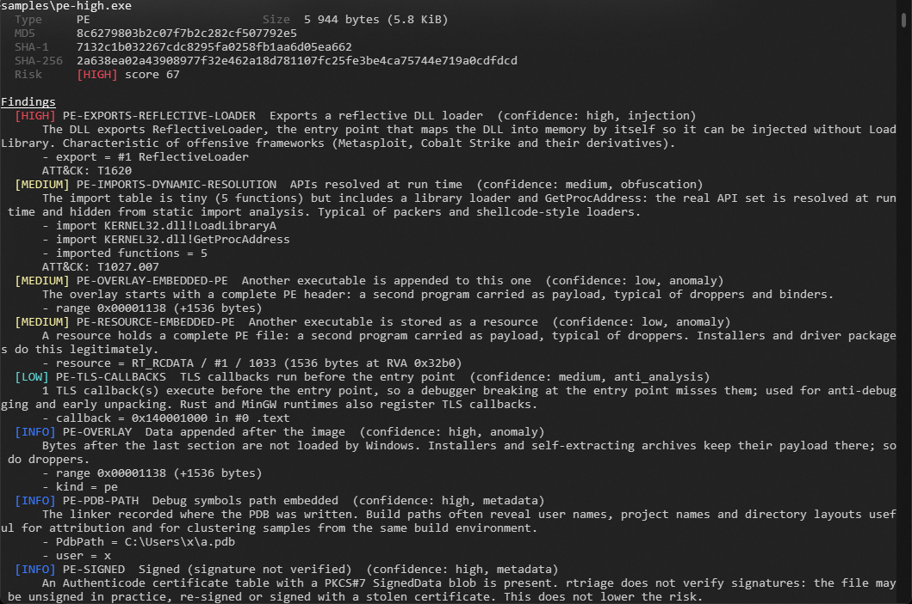
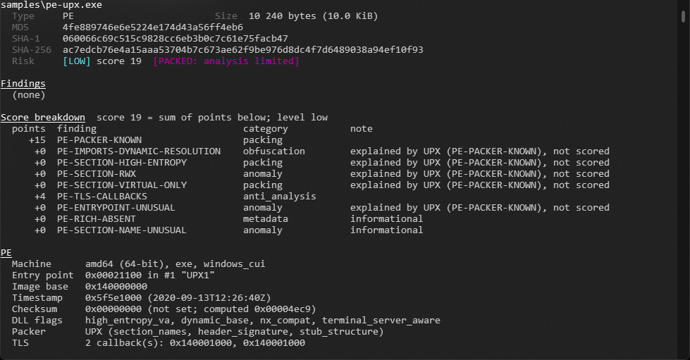
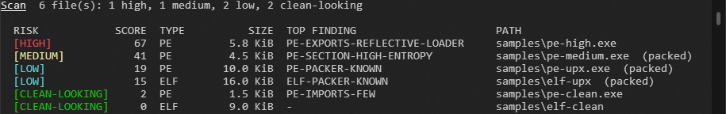
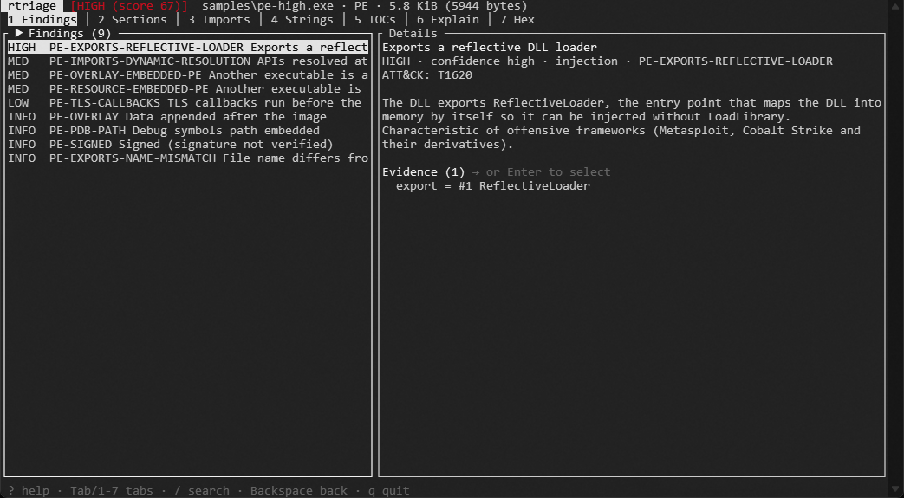

<p align="center"><picture>
  <source media="(prefers-color-scheme: dark)" srcset="assets/brand/rtriage-logo-dark.svg">
  
</picture></p>

<p align="center"><b>Статичний триаж бінарників PE та ELF</b><br>
<a href="README.md">English</a> · Українська</p>

Отримавши файли чи теки, `rtriage` за секунди відповідає: *що це за файл,
чи виглядає він підозріло і чому?* Кожна знахідка несе конкретні докази, які
її спричинили (зсув, секція, імпорт, рядок, значення ентропії), а оцінку
ризику можна розкласти до кожного бала.

**rtriage ніколи не запускає, не завантажує і не емулює файли, які
аналізує.** Кожен вхідний файл вважається ворожим: парсери обмежені й не
панікують, вивід очищено від ін'єкцій escape-послідовностей у термінал, а
пакетні запуски аналізують кожен файл в окремому ізольованому процесі.

> **Статус: попередній реліз.** Етапи 1–6 завершено (ядро, PE, ELF + IOC,
> YARA + пакетний режим, TUI, вивід у Markdown). До 1.0 CLI може змінюватися;
> JSON-схема дотримується правил версіонування з
> [`docs/output-schema.md`](docs/output-schema.md).

Документація в `docs/` англійською; цей файл — переклад основного
[README](README.md).

## Скріншоти

Усі скріншоти зроблено на синтетичних файлах із `samples/` (див.
[Розробка](#розробка)); жодної справжньої малварі.

| Звіт | Розклад оцінки (`--explain`) |
|---|---|
|  |  |
| **Пакетна таблиця (`scan`)** | **Інтерактивний режим (`tui`)** |
|  |  |

## Встановлення

### Готові бінарники

У [GitHub Releases](https://github.com/VoroN5k/rtriage/releases) є архіви
для Linux x86_64, Windows x86_64, macOS Apple Silicon і macOS Intel, зібрані
з YARA і TUI. У кожному архіві — бінарник `rtriage`, `LICENSE` і README.

Перевірте завантажене, перш ніж запускати:

```bash
# Linux / macOS: контрольні суми (SHA256SUMS додано до релізу)
sha256sum -c SHA256SUMS --ignore-missing        # macOS: shasum -a 256 -c SHA256SUMS --ignore-missing

# Windows (PowerShell): порівняйте з рядком у SHA256SUMS
Get-FileHash -Algorithm SHA256 .\rtriage-v0.1.0-x86_64-pc-windows-msvc.zip

# Походження: архів зібрав release-workflow саме цього репозиторію
gh attestation verify rtriage-v0.1.0-<target>.tar.gz --repo VoroN5k/rtriage
```

**Бінарники не підписані сертифікатом.** Сертифікати для підпису коштують
грошей і прив'язують проєкт до постачальника; натомість кожен реліз має
контрольні суми й атестацію походження збірки, які можна перевірити
самостійно. Windows SmartScreen і macOS Gatekeeper попереджатимуть про
невідомого видавця. Після перевірки архіву дозволити його (на macOS,
наприклад, `xattr -d com.apple.quarantine rtriage`) — ваше рішення.

### Із сирців

```bash
cargo install --git https://github.com/VoroN5k/rtriage --locked --features yara rtriage-cli
```

Потрібен Rust 1.95 або новіший (див. [Збірка](#збірка)). Без
`--features yara` збірка менша, але без YARA.

## Модель безпеки

- **Лише статика.** Вхідні файли читаються, але ніколи не запускаються, не
  завантажуються і не емулюються.
- **Ворожий вхід за замовчуванням.** Парсери обмежені налаштовуваними
  лімітами (розмір файлу, кількості, довжини рядків, час на файл), не
  панікують на зіпсованих даних, їх фазять і перевіряють property-тестами.
- **Безпечний вивід.** Керівні символи, escape-послідовності, bidi- та
  невидимі символи з файлу в терміналі екрануються; у Markdown кожне
  значення з файлу — це code span, тож нічого не стає посиланням,
  зображенням чи HTML.
- **Ізоляція.** Пакетні запуски аналізують кожен файл в окремому
  процесі-обробнику; збій, зависання чи флуд втрачає лише цей файл.
- **Без мережі й телеметрії.** rtriage не встановлює мережевих з'єднань.

Як повідомити про вразливість: [`SECURITY.md`](SECURITY.md).

## Обмеження

- **Без розпакування.** rtriage статичний: для запакованого файлу видно
  пакувальник і його сліди, а не корисне навантаження всередині.
- **Евристики, а не вироки.** Знахідки бувають хибнопозитивними, а оцінка
  ризику лише впорядковує файли для уважнішого огляду; вона не каже, що
  файл шкідливий чи безпечний.
- **Підписи не перевіряються.** Authenticode позначається як наявний
  («signed (unverified)»), але не валідується.
- **Формати:** лише PE і ELF. Без Mach-O, .NET IL, скриптів і документів
  Office.
- **YARA** працює лише у збірках із функцією `yara` (релізні бінарники її
  мають).
- **До 1.0.** CLI може змінюватися між релізами; JSON-схема версіонується
  (`schema_version`).
- **Непідписані бінарники** (див. [Встановлення](#встановлення)).

## Що аналізується

- **Будь-який файл:** хеші, ентропія (усього файлу та ділянок із високою
  ентропією), рядки ASCII/UTF-16 з класифікацією, IOC (URL, домени, IP з
  областю, email, гаманці; allowlist; знешкодження), правила YARA.
- **PE:** заголовки, секції, імпорти + imphash, сумісний із pefile, групи
  поведінки API (ін'єкція, закріплення, C2, доступ до облікових даних, ...),
  експорти, ресурси, Rich header, TLS-колбеки, шляхи debug/PDB, overlay,
  наявність Authenticode, пакувальники (UPX підтверджується кількома
  ознаками).
- **ELF:** заголовки, інтерпретатор, сегменти/секції, динамічна секція й
  зведення захистів у стилі checksec, символи та групи поведінки API,
  notes, UPX, розпізнавання рантаймів Go/Rust.

Знахідки, їхні пороги й примітки щодо хибних спрацювань:
[`docs/heuristics.md`](docs/heuristics.md).

## Збірка

```bash
cargo build --release -p rtriage-cli                        # TUI, без YARA (мала, швидко збирається)
cargo build --release -p rtriage-cli --features yara        # TUI + YARA (yara-x)
cargo build --release -p rtriage-cli --no-default-features  # без обох: простий CLI
```

| Збірка | Бінарник | Чиста release-збірка | Залежностей у `rtriage-cli` |
|---|---|---|---|
| за замовчуванням (TUI) | ~4.7 MiB | ~1 хв | 116 крейтів |
| `--no-default-features` | ~4.2 MiB | ~1 хв | 73 крейти |
| `--features yara` | ~17 MiB | ~6 хв | 262 крейти |

(Windows x86_64; крейти пораховано через `cargo tree -e normal`.)

**MSRV:** Rust 1.95 або новіший (`rust-version` у `Cargo.toml`; інструменти
для розробки закріплено в `rust-toolchain.toml`). Функція `test-hooks`
існує лише для тестів ізоляції обробників; ніколи не вмикайте її у збірці,
яку поширюєте.

## Використання

```bash
rtriage sample.exe                        # повний звіт, аналіз у цьому процесі
rtriage --explain sample.exe              # ... плюс розклад оцінки
rtriage -f json -o report.json sample.exe # версіонований JSON
rtriage --defang sample.exe               # hxxp://evil[.]com, 1[.]2[.]3[.]4 у тексті
rtriage -f md sample.exe > report.md      # Markdown для тікета, issue чи вікі

rtriage samples/                          # кожен файл, повні звіти, процеси-обробники
rtriage scan samples/ -j 8                # пакетна таблиця, відсортована за ризиком
rtriage scan samples/ -f json > out.ndjson          # NDJSON, один підсумковий рядок
rtriage scan samples/ --full -f json > out.ndjson   # ... плюс рядок на кожен звіт
rtriage scan samples/ -f md               # таблиця в Markdown, відсортована за ризиком

rtriage scan samples/ --fail-on medium    # код 3, якщо хоч один файл medium або гірше (CI)
rtriage --rules-dir my-rules/ sample.exe  # ваші правила поверх вбудованих
rtriage --yara extra.yar --yara rules/ x  # додаткові правила YARA (збірка з yara)
rtriage --no-yara sample.exe              # без YARA, навіть без вбудованих правил

rtriage tui sample.exe                    # інтерактивний режим (див. нижче)
```

| Виклик | Де аналізуються файли | Вивід |
|---|---|---|
| один файл | у цьому процесі | повний звіт |
| кілька файлів, будь-яка тека | ізольовані процеси-обробники (`-j`) | повні звіти в порядку введення |
| `scan` | ізольовані процеси-обробники | таблиця за ризиком (або NDJSON) |

Теки обходяться рекурсивно, у відсортованому порядку, без переходу за
символьними посиланнями; FIFO та пристрої пропускаються. Обробник, що
впав, завис довше за `--timeout` + 5 с або завалив вивід, втрачає лише
свій файл; файл позначається як `crashed`, `timed_out` чи
`invalid_response`, і роботу продовжує новий обробник.

### Вивід у Markdown

`-f md` пише один документ (`# rtriage report`) для тікета, issue чи
вікі-сторінки: ті самі розділи, що й текстовий звіт, таблиці там, де в
тексті стовпці, кілька файлів у порядку введення через розділювачі, а
потім файли, що не вдалося проаналізувати, і пропущені. `scan -f md`
пише спершу таблицю ризиків, а з `--full` — після неї кожен звіт.

- **Ніщо з файлу не стає розміткою.** Кожне значення з файлу (імена,
  рядки, шляхи, докази, імена правил YARA, ім'я файлу в заголовках) — це
  inline code span, тож на сторінці не з'являються посилання, зображення,
  HTML, @згадки чи #посилання. Значення довші за 200 символів обрізаються
  із зазначенням повної довжини; описи знахідок — до 1 000.
- **Завжди знешкоджено.** URL, домени, IP та email виглядають як
  `hxxp://evil[.]com`, `1[.]2[.]3[.]4`. `--no-defang` показує їх як є;
  `--defang` у Markdown нічого не змінює.
- **Обмеження розміру.** GitHub не приймає тексти issue й коментарів
  довші за 65 536 символів, тож за замовчуванням документ обривається на
  60 000 (`--md-limit N`, `0` — без обмеження). Обрізання йде по межі
  рядка (таблиці зберігають цілі рядки), а примітка каже, скільки рядків і
  символів пропущено; файли з помилками та пропущені перелічуються в
  зарезервованій частині наприкінці (лише дуже довгий список обрізається
  сам, зі своєю приміткою). Обрізання ніколи не змінює код виходу чи
  `--fail-on`.
- `--no-defang` і `--md-limit` з іншим форматом — помилка використання
  (код 2).
- `scan --full -f md` тримає звіти, доки не буде записано таблицю, але
  лише стільки, скільки вміщує ліміт; з `--md-limit 0` — усі, тож для
  дуже великих наборів використовуйте `-f json`.

Markdown — для людей; машинний формат — `-f json`.

### Коди виходу

| Код | Значення |
|---|---|
| `0` | Усі файли проаналізовано (і поріг `--fail-on` не досягнуто). |
| `1` | Хоча б один файл не вдалося проаналізувати, або вивід не вдалося записати. |
| `2` | Помилка використання: хибні прапорці, некоректні правила, правила YARA для збірки без YARA. |
| `3` | Досягнуто порогу `--fail-on`. Має пріоритет над `1` (з попередженням). |

## TUI

`rtriage tui <FILE>` аналізує один файл у фоні (Esc або `q` скасовує;
скасований звіт позначається **PARTIAL**, а ризик показується як
`INCOMPLETE`, ніколи не `clean-looking`) і відкриває інтерактивний режим.
Параметри аналізу (`--rules-dir`, `--yara`, `--timeout`, `--max-size`)
діють. Потрібен термінал на stdin і stdout; у конвеєрі виходить із кодом 2.

| Вкладка | Що показує |
|---|---|
| `1` Findings | список знахідок; деталі й докази праворуч, `Enter` переходить до доказу |
| `2` Sections | секції PE, заголовки секцій ELF (`s`: program headers) |
| `3` Imports | функції PE за DLL з imphash, символи ELF |
| `4` Strings | усі витягнуті рядки; `f` фільтрує за класом і довжиною, `x` скидає |
| `5` IOCs | хеші файлу, потім індикатори; знешкоджені, `d` показує як є |
| `6` Explain | як обчислено оцінку; `Enter` відкриває знахідку |
| `7` Hex | дамп лише для читання; доказ-діапазон відкриває його з підсвіткою, `g` — перехід до зсуву |

`Backspace` (або Alt-←) повертає назад після переходу. `/` шукає в
поточному списку, `n`/`N` — між збігами. `?` показує всі клавіші. Потрібно
щонайменше 60×16; усе, що взято з файлу, показано з екранованими
керівними, bidi- та невидимими символами.

**Копіювання.** `y` копіює вибране значення очищеним: один рядок, видимі
escape-послідовності, знешкоджені URL та IP. `Y` копіює точно як є, після
підтвердження (там можуть бути керівні символи). Хеші копіюються як є.
Копіювання використовує буфер обміну термінала (OSC 52), тож працює й
через SSH, до 64 KiB, якщо термінал це дозволяє. Багато сучасних
терміналів дозволяють (наприклад, Windows Terminal, kitty, WezTerm);
деякі потребують увімкнення (налаштування доступу до буфера в iTerm2,
`disallowedWindowOps` в xterm). Рядок стану каже, що надіслано, а не чи
прийняв це термінал.

- **tmux:** задайте `set -g set-clipboard on`. З `external`, яке, за
  повідомленнями користувачів, є значенням за замовчуванням, tmux ігнорує
  послідовність від застосунків. Усередині tmux rtriage надсилає звичайну
  послідовність, тож `allow-passthrough` не потрібен (він важливий лише для
  обгортки `\ePtmux;`).
- **GNU screen:** послідовність для screen обгортається автоматично.

## Власні правила

`--rules-dir DIR` читає лише ці імена; кожне необов'язкове, і без нього
використовуються вбудовані дані з [`rules/`](rules/):

| У `DIR` | Дія |
|---|---|
| `api_groups.toml`, `elf_api_groups.toml` | групи поведінки PE / ELF: замінюють вбудовані або зливаються з ними при `include_defaults = true` |
| `packers.toml` | пояснення пакувальників і рантаймів (те саме правило злиття) |
| `ioc_allowlist.toml` | домени, що додаються до allowlist IOC |
| `yara/` | файли правил YARA, що додаються до вбудованих |
| `yara.toml` | `include_bundled` та ліміти завантаження/сканування YARA |

Правила YARA можуть мати метадані rtriage (`severity`, `confidence`,
`category`, `attack`, `risk_floor`, `description`), які перевіряються під
час завантаження правил. Формати й ліміти:
[`docs/heuristics.md`](docs/heuristics.md).

## Документація

- [`docs/heuristics.md`](docs/heuristics.md): кожна знахідка, оцінювання v1, ліміти, пояснення, власні правила.
- [`docs/output-schema.md`](docs/output-schema.md): схема JSON і NDJSON, правило сумісності, коди виходу.
- [`docs/robustness.md`](docs/robustness.md): ліміти, дедлайни, захист від паніки, ізоляція обробників, як це тестується.
- [`fuzz/README.md`](fuzz/README.md): цілі для фазингу.

## Розробка

```bash
cargo test --workspace                    # функції за замовчуванням
cargo test --workspace --all-features     # з YARA і тестовими хуками обробників
cargo clippy --workspace --all-targets --all-features -- -D warnings
PROPTEST_CASES=100000 cargo test -p rtriage-core --release --all-features --test robustness_elf
PROPTEST_CASES=10000 cargo test -p rtriage-tui --release --test robustness   # випадкові клавіші, увесь TUI
cargo test -p rtriage-tui --release --test perf -- --ignored                 # швидкість списку рядків
cargo bench -p rtriage-tui --bench strings_list
cargo insta review                        # після навмисної зміни екрана
```

Екрани TUI перевіряються снапшот-тестами `insta` на 80×24 і більше.

Синтетичні зразки (нешкідливі, згенеровані з тестових фікстур), щоб
спробувати rtriage або зробити скріншоти:

```bash
cargo run -p rtriage-fixtures --example samples --locked -- samples
rtriage scan samples/
```

Тести використовують лише синтетичні фікстури, зібрані програмно; справжньої
малварі в цьому репозиторії немає й не буде.

## Ліцензія

Поширюється за GNU General Public License v3.0 або новішою; див. [LICENSE](LICENSE).
